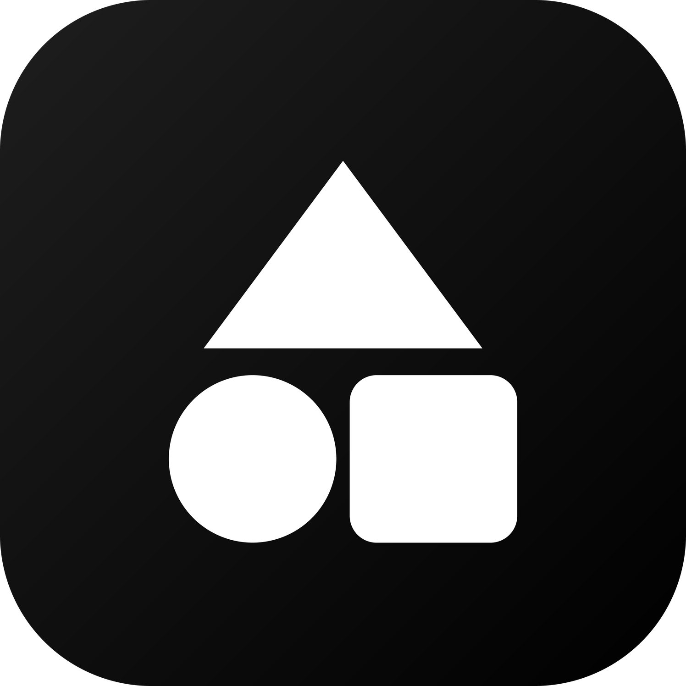

  

  # Orion Zero

  A fast, no-clutter store for modded and open-source Android apps. 
  Black and white. No ads, no game, no AI, no gamification.

> This is a fork of [RookieEnough/Orion-Store](https://github.com/RookieEnough/Orion-Store), licensed under **GPL-3.0**.
> The original copyright notices are kept, and this fork is released under the same license.

## What this fork changes

- **Monochrome UI.** One pure-gray palette (equal R, G and B), in Light, Dark, Dusk and OLED. Errors keep a muted red so failures stay readable. Default theme is Dark.
- **Black logo.** Same triangle, circle and square, now on black. Launcher icons, splash screen and store assets are all regenerated.
- **Removed:** the Dev tab (developer profile, coin, leaderboard, Fuel the Code), Unity Ads, profile cards and badges, custom bundles and app submissions, Orion AI and its on-device model support, the Dino game, pixel pull-to-refresh characters, 13 of 14 color palettes, the in-app guide and tour, hidden developer options, and the legacy React/Capacitor app.
- **Kept:** the catalog and search, app detail pages, My Apps and updates, background auto-update, installers (system, Shizuku, root, wireless ADB), Guardian and Sentinel, VirusTotal checks, backup and restore, and theming settings.

